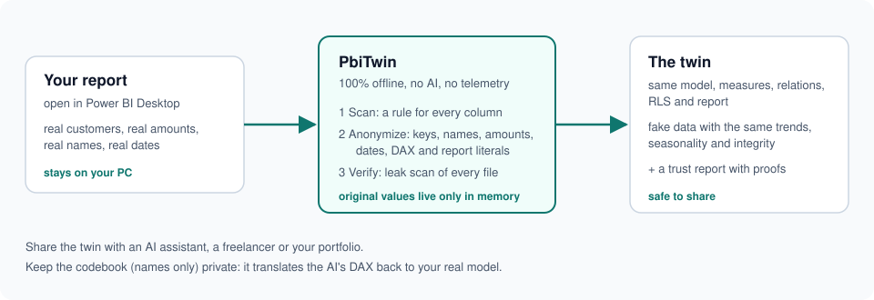

# PbiTwin

**An anonymized twin of your Power BI model, created 100% locally.**

> *AI wrote DAX for a client's model without seeing a single real number.*

Clients rarely allow their real data to be shared with AI tools, freelancers or a portfolio. Anonymizing
a model by hand is slow and tedious, so nobody does it. PbiTwin does it in a minute: open a report in
Power BI Desktop, run the wizard, and get a **twin** — the same model, measures, relationships, RLS and
report, but with fake data that keeps the distributions, trends, seasonality and referential integrity.



### Before and after

Rows from the bundled fake sample (`samples/ContosoPII`), one of 2,000 customers and one of about 196,000 order lines, run with the default options:

| | CustomerKey | FullName | Email | City | Segment |
|---|---:|---|---|---|---|
| original | 1 | Serhii Kovalenko | serhii.kovalenko@meta.ua | Kyiv | Consumer |
| twin | 1506 | Yara Stonebridge | thane.ironside70@example.net | Torford | Segment 02 |

| | OrderNumber | OrderDate | CustomerKey | UnitPrice | SalesAmount |
|---|---|---|---:|---:|---:|
| original | SO-2022-000001 | 2022-01-01 | 1347 | 95.24 | 90.48 |
| twin | ON-049263 | 2024-12-07 | 452 | 83.14 | 79.2 |

Keys, names and dates change, amounts are rescaled, and everything that holds the model together stays intact:
every order still finds its customer, monthly totals correlate 1.0000 with the original, margins move by hundredths of a percent.
The full [sample trust report](docs/sample/TRUST-REPORT.md) is what every run produces.

- **Offline.** No network calls, no telemetry, no auto-update, no AI. Enforced by a CI check.
- **Open source (MIT).** About 4,700 lines of core code (with comments) and two official Microsoft packages. Read it in an evening, build it yourself.
- **Verified.** Every run ends with a trust report: row counts, referential integrity, key uniqueness, a leak scan of every output file, and proof that trends and ratios survived.

## Quick start

1. Save your report as a **Power BI Project (.pbip)** and keep it open in Power BI Desktop.
2. Download `PbiTwin.exe` from [Releases](../../releases) (a single file, nothing to install; or [build it yourself](#build-from-source)), run it,
   pick the running model and the `.pbip` file, review the rules, click **Create twin**.
3. Open `<Name>_Twin.pbip`, *Refresh*, and share the twin folder (never the `.codebook.json` next to it).

Verify the download: `Get-FileHash PbiTwin.exe` must match the line in `SHA256SUMS.txt` of the release.
The executables are not code-signed, so Windows SmartScreen may ask for confirmation.

## What gets anonymized

| Detected as | How it is detected | What the twin gets |
|---|---|---|
| Key | used in a relationship, marked as key, `*Key`/`*ID` names, ID-like codes | one-to-one replacement (`1..n` or `ON-000123`), identical in every related table |
| Person name | column name + value pattern | invented name (`Wren Hawthorne`) |
| Email / Phone / IBAN | value patterns + name | fake of the same shape (`…@example.com`, digits replaced) |
| Address | name or data category | invented street address |
| City / Country | name or data category | invented place (`Kelhaven`, `Eskaria`), one-to-one |
| Category / label | ≤ 50 distinct values / other short text | `Segment 01`, `Store 14`, one-to-one |
| Free text | long text | lorem ipsum of similar length |
| Money | decimal type or amount-like name | × one secret factor ± per-row noise (3% by default) |
| Quantity | whole numbers that are not keys | × its own factor ± noise, rounded, never zero |
| Date | date/time type | shifted by one offset of whole weeks (≈ whole years) |
| Boolean / percent | type / values between 0 and 1 | kept |

You can override every rule in the wizard, and save the reviewed rules (column names and rules only, no data)
to reuse them on the next run of the same model. Literals that hold original values are rewritten consistently
in measures, calculated columns, calculation items, RLS filters, report filters, titles and textboxes, so
`CALCULATE([Revenue], DimCustomer[Segment] = "Enterprise")` still works in the twin. Original data
sources, server names and parameters are removed; descriptions and annotations are cleaned by default.

### Hide the names too

Optionally, tables, columns, measures, hierarchies and roles are renamed — neutrally (`Table01[Col03]`,
`[Measure07]`) or semantically (`FactA`, `DimB`) — and every DAX expression and report reference is rewritten
to match. A **codebook** (names only, no data) is saved *next to* the twin folder. Ask an AI to write a measure
against the twin, paste it into **Translate DAX**, and get the same measure for your real model:

```
CALCULATE([Measure01], DimC[Col04] = "Region 02")   →   CALCULATE([Revenue], DimStore[Region] = "Region 02")
```

## How it stays private

- Reads data only from Power BI Desktop on `localhost`; any other connection string is refused.
- Original values live only in memory. Nothing original is written to disk: not in logs, temporary files, the trust report or the twin.
- The source project is never modified; the twin is a copy.
- The seed that drives all pseudonyms is random per run, shown in the UI, and never saved.

See [docs/TRUST.md](docs/TRUST.md) for the data flow, the dependency list and how to verify all of this yourself,
and [docs/HOW-IT-WORKS.md](docs/HOW-IT-WORKS.md) for the algorithms.

## Limitations

- Windows and Power BI Desktop only. Models in the Power BI Service (XMLA) are not supported yet.
- The twin's data is CSV in Import mode; DirectQuery behaviour and performance are not reproduced.
- Classification is heuristic. Always review the Scan step.
- Size: data is streamed, but every distinct original text value of anonymized columns is kept in memory for
  one-to-one mapping and the leak scan — about 0.5 GB per million distinct identifiers (e.g. order numbers).
  A 2-million-row fact table takes ~20 seconds on a laptop. For very large models, use the fact row limit.
- Hard-coded numbers and dates in DAX (e.g. `Sales[Amount] > 1000000`, `DATE(2024, 1, 1)`) are not rewritten; the trust report lists every expression where this changes the result.
- Names are kept unless you turn on renaming. Without it, a value used as a name (e.g. a measure called *Kyiv Revenue*) is reported as a leak.
- When renaming, names that DAX creates itself (e.g. `"Year"` in `ADDCOLUMNS` inside a calculated table) stay as they are. Calculation item names and field-parameter labels are not renamed.
- Images in the report (logos, button backgrounds, `RegisteredResources`) are copied as-is. A logo that shows your client's name stays in the twin.
- This is not anonymization in the legal sense (e.g. GDPR). It is a tool for safe development, demos and sharing with AI assistants.

## Command line

`pbitwin-cli.exe` does the same without the wizard, for scripts and CI:

```
pbitwin-cli list
pbitwin-cli scan --pbip C:\Reports\Sales.pbip --port 52123          # show the rules a run would use, create nothing
pbitwin-cli --pbip C:\Reports\Sales.pbip --port 52123 --out C:\Twins\Sales_Twin --rename semantic --rows 1000000 --rules sales.pbitwin-rules.json
pbitwin-cli translate --codebook C:\Twins\Twin.codebook.json --to real < measure.dax
```

It prints the trust report checks and exits with `0` (all passed), `2` (twin created, some checks failed) or `1` (error).
With `--csv <folder>` instead of `--port` it reads the original data from CSV files — this is how the tests run on Linux.

## Build from source

Requires the .NET 8 SDK.

```
git clone https://github.com/denchik2013/pbi-twin
cd pbi-twin
dotnet test
dotnet run --project src/PbiTwin.App
```

Try it on the bundled sample: `dotnet run --project samples/generator`, then follow [docs/E2E-CHECKLIST.md](docs/E2E-CHECKLIST.md).

## FAQ

**Can the twin be reversed?** Not without the seed. Pseudonyms come from HMAC-SHA256 keyed with the seed,
and amounts are scaled by a secret factor. Small fake datasets can still leak *shape* (e.g. how many
customers there are) — that is the point of a twin.

**Why does the trust report not show the factor or the seed?** Because the report is meant to be shared with the twin.

**Does it use AI to classify columns?** No. Plain, readable heuristics in `src/PbiTwin.Core/Classify`.

## License

[MIT](LICENSE)
