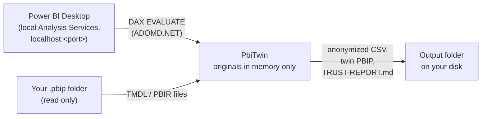

# Why you can trust PbiTwin

PbiTwin handles exactly the data you are not allowed to share. This page explains where that data goes
(nowhere), what the program is made of, and how to check all of it yourself instead of taking our word for it.

## Data flow



There is no other arrow. PbiTwin opens no sockets of its own, sends no telemetry, checks for no updates
and calls no AI service.

## Guarantees and how they are enforced

| Guarantee | Enforced by |
|---|---|
| No networking code in the app | [`check-no-network.sh`](../.github/scripts/check-no-network.sh) runs on every push and fails on `System.Net`, `HttpClient`, `WebClient`, `WebRequest`, sockets, `Dns` or `Process.Start` with a URL in `src/`. The same check runs as a unit test. The SDK's implicit `using System.Net.Http` is removed. |
| Connects to localhost only | [`LocalhostGuard`](../src/PbiTwin.Core/Connection/LocalhostGuard.cs) refuses every connection string that is not exactly `localhost:<port>` or `127.0.0.1:<port>`, with no extra keys. Covered by tests. |
| Only approved dependencies | [`DependencyAllowlistTests`](../tests/PbiTwin.Core.Tests/Guards/DependencyAllowlistTests.cs) fail if any package outside the list below is added. Versions are pinned; `packages.lock.json` is committed and CI restores in locked mode. |
| No original values on disk | The only files written are the twin's. The trust report and warnings contain counts and column names, never values. |
| No leaks in the twin | Every run scans every output file for every original text value (4+ characters) of every anonymized column. |
| Source is not modified | The project is read; the twin is written to a separate folder. The output folder may not be, contain or sit inside the project folder (`TwinFolder.EnsureSeparate`, tested), and an existing folder is only replaced if PbiTwin created it. |
| Caches are not carried over | `.pbi` folders, `*.abf`, `*.pbix`, `*.bak` and symbolic links are never copied. Files that are neither text nor pictures are copied but reported in the trust report, because the leak scan cannot read them. |
| The seed stays secret | It is random (80 bits from the system generator), shown once, and written nowhere, which a test checks over the whole output. A short user-chosen seed is reported as a weakness. |
| Kept columns are visible | Columns that look personal (names, emails, phones, IBANs, addresses, free text) but were set to *Keep* are listed in the trust report. |
| Every connection is guarded | A test fails if any code that opens a connection does not call the localhost guard first. |
| CI is hardened | GitHub Actions are pinned to commit SHAs, workflows have read-only permissions (the release job alone can write), and a test fails on an unpinned action. |
| Reproducible build | Deterministic compilation, path mapping, locked packages. |

## Dependencies

Direct (runtime):

| Package | Version | Why |
|---|---|---|
| [Microsoft.AnalysisServices.AdomdClient](https://www.nuget.org/packages/Microsoft.AnalysisServices.AdomdClient) | 19.118.3 | Run DAX queries against Power BI Desktop |
| [Microsoft.AnalysisServices](https://www.nuget.org/packages/Microsoft.AnalysisServices) | 19.118.3 | Read and write the model (TOM, TMDL) |

Brought in by those two (all Microsoft): `Microsoft.Identity.Client` (MSAL), `Microsoft.Identity.Client.Broker`,
`Microsoft.Identity.Client.NativeInterop`, `Microsoft.IdentityModel.Abstractions`, `System.Diagnostics.DiagnosticSource`,
`System.Runtime.CompilerServices.Unsafe`, `System.ValueTuple`.

MSAL is the Azure sign-in library used when the Analysis Services clients connect to a cloud server. PbiTwin
only ever connects to `localhost`, where no sign-in happens, so MSAL is loaded but never asked to authenticate.
You can confirm this with the firewall test below.

Tests only: `xunit`, `xunit.runner.visualstudio`, `Microsoft.NET.Test.Sdk`.

Build only: `Microsoft.NET.ILLink.Tasks`, the single-file analyzer that the .NET SDK adds itself. It checks the
code at build time and is not part of the executables.

Everything else (CSV, hashing, fake data, the DAX lexer, the leak scanner) is written in this repository using only the .NET base library.

## Check it yourself

1. **Read the code.** The core is about 4,400 lines (with comments) in `src/PbiTwin.Core`; the wizard and the command line have no logic of their own.
2. **Build it yourself** instead of downloading the exe: `dotnet build -c Release src/PbiTwin.App`, or reproduce the release with the `dotnet publish` command in [release.yml](../.github/workflows/release.yml) and compare with `SHA256SUMS.txt`.
3. **Run it with the network off.** Disconnect Wi-Fi/Ethernet, or add a Windows Firewall rule:
   ```powershell
   New-NetFirewallRule -DisplayName "Block PbiTwin" -Direction Outbound -Program "C:\path\to\PbiTwin.exe" -Action Block
   ```
   PbiTwin works the same: it only talks to Power BI Desktop over the loopback interface.
4. **Watch it with Process Monitor** ([Sysinternals](https://learn.microsoft.com/sysinternals/downloads/procmon)): filter
   *Process Name is PbiTwin.exe* and look at the *Network* and *File System* activity. You will see TCP traffic to
   `localhost:<port>` only, and file writes only in the output folder.
5. **Search the twin** for a real customer name, email or city (e.g. `findstr /s /i "Kovalenko" *.*` in the output
   folder). Nothing should be found — and the trust report already did this for every value.
